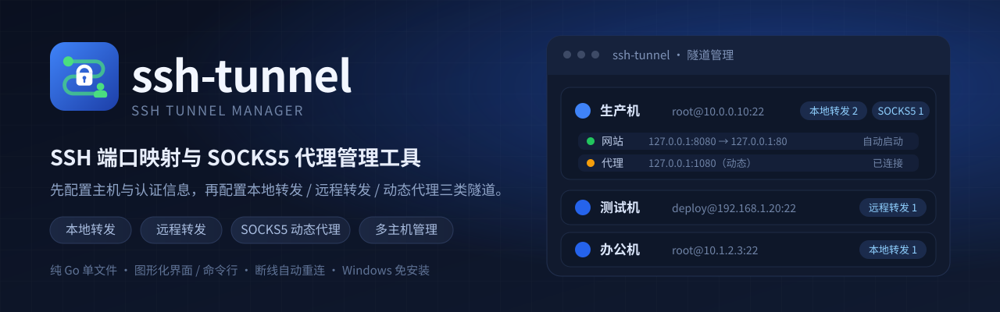

# ssh-tunnel

[English](README.en.md) | **简体中文**



用 Go 实现的 SSH 端口映射 / SOCKS5 代理管理工具，提供原生管理界面、系统托盘和命令行。
支持自动重连、保活、主机密钥校验与开机自启动。

## 功能

- 本地 / 远程端口映射与 SOCKS5 代理；
- 连接状态实时展示，断线指数退避重连，默认 30s 保活；
- 原生窗口（Windows WebView2）与系统托盘，单实例运行；
- 界面与命令行支持简体中文 / English，支持跟随系统 / 深色 / 浅色主题；
- 主机密钥校验，未知主机 TOFU，密钥变更拒绝连接；
- Windows 注册表自启动；Linux 支持 XDG、systemd 用户 / 系统服务与 crontab。

## 安装

需要 Go 1.26 及以上。

```bash
git clone <repo> && cd ssh-tunnel
make build            # bin/ssh-tunnel
make build-windows    # bin/ssh-tunnel.exe
```

也可以直接 `go build -o ssh-tunnel ./cmd/ssh-tunnel`。

Windows 需要 WebView2 运行时；Linux / macOS 的原生窗口需要 cgo、gtk3 与 webkit2gtk-4.0，
可用 `make build-webview` 构建。默认构建在没有原生窗口时回退到系统浏览器。

## 快速开始

### 1. 准备认证

```bash
ssh-keygen -t ed25519 -f ~/.ssh/id_ed25519
```

### 2. 新建配置

```bash
./ssh-tunnel
```

默认配置为 `~/.config/ssh-tunnel/config.json`，`ssh-tunnel config path` 可打印实际路径。
旧版的 `~/.ssh-tunnel/config.json` 会在新位置为空时自动复制过来。

配置示例：

```json
{
  "hosts": [
    {
      "id": "h1a2b3c4d",
      "name": "prod",
      "host": "10.0.0.10",
      "port": 22,
      "auth": { "type": "key", "user": "root", "keyPath": "~/.ssh/id_ed25519" }
    }
  ],
  "tunnels": [
    {
      "id": "t5e6f7a8b",
      "hostId": "h1a2b3c4d",
      "name": "website",
      "type": "local",
      "listen": "127.0.0.1:8080",
      "target": "127.0.0.1:80",
      "autoStart": true
    }
  ]
}
```

主机保存地址和认证信息；隧道保存映射关系，`autoStart` 表示程序运行时自动连接。
`name` 留空时分别回退为地址、类型加监听地址。旧版 `profiles` 会自动迁移成主机与隧道。

隧道类型：

| 类型 | 含义 | `listen` | `target` |
| --- | --- | --- | --- |
| `local` | 本地转发 | 本地监听地址 | 远端目标地址 |
| `remote` | 远程转发 | 远端监听地址 | 本地目标地址 |
| `socks5` | SOCKS5 代理 | 本地监听地址 | 可选，留空为动态代理 |

认证方式：

- `key`：私钥，`keyPath` 指向私钥文件，私钥口令可选；
- `password`：密码；
- `agent`：使用 `SSH_AUTH_SOCK` 指向的 ssh-agent。

密码、私钥内容与私钥口令**不保存在配置文件里**，而是放在系统密钥环中
（Windows 凭据管理器 / macOS 钥匙串 / Linux Secret Service）；系统没有可用密钥环时，
退回到配置目录下的加密文件 `secrets.enc`。详见 [安全说明](#安全说明)。

### 3. 使用

```bash
./ssh-tunnel                            # 打开图形界面
./ssh-tunnel run website                # 前台运行单个隧道
./ssh-tunnel daemon [隧道...]            # 后台运行隧道
./ssh-tunnel tray                       # 驻留系统托盘（Windows）
./ssh-tunnel autostart on|off|status [方式]
./ssh-tunnel service start|stop|restart|status [方式]
./ssh-tunnel config list|show|host|tunnel
./ssh-tunnel config path
```

全局参数：`--config <文件>`、`--addr <地址>`、`--no-open`、`--lang <zh-CN|en-US>`。
`--config` 可以放在子命令前后。

## 界面

界面包含「隧道」「日志」「设置」三个页签，支持中英文切换和跟随系统 / 深色 / 浅色主题，
页头显示当前版本与官网链接。「隧道」按主机分组，可展开查看、启停、编辑或删除隧道；
「日志」实时显示连接与转发事件。

「设置」可修改语言、主题、开机自启动、保活间隔、连接超时与重连参数。连接与重连参数保存后，
运行中的隧道会自动重启一次。同一 `user@host:port` 不能重复添加。

Windows 只有启动项一种自启动方式，界面会隐藏“方式”选择；Linux 可在 XDG、systemd 与
crontab 间选择。

## 命令行管理

```bash
ssh-tunnel config list
ssh-tunnel config show prod
ssh-tunnel config host add prod \
  --host 10.0.0.10 --port 22 --user deploy --auth key --key ~/.ssh/id_ed25519
ssh-tunnel config host edit prod --port 2200
ssh-tunnel config host remove prod

ssh-tunnel config tunnel add website \
  --host prod --type local --listen 127.0.0.1:8080 --target 127.0.0.1:80 --auto-start
ssh-tunnel config tunnel add proxy \
  --host prod --type socks5 --listen 127.0.0.1:1080
ssh-tunnel config tunnel edit website --target 127.0.0.1:8081
ssh-tunnel config tunnel remove website
```

主机选项：`--name`、`--host`、`--port`、`--user`、`--auth`、`--key`、`--password`、
`--passphrase`、`--auto-reconnect`、`--no-auto-reconnect`、`--insecure-host-key`。

凭据的给法（三选一，后者不会把密码留在进程列表里）：

```bash
# 1) 直接给（会出现在进程列表里）
ssh-tunnel config host add prod --host 10.0.0.10 --user root --password 密码

# 2) 从标准输入读
echo -n 密码 | ssh-tunnel config host add prod --host 10.0.0.10 --user root --password -

# 3) 从环境变量读
SSH_TUNNEL_PASSWORD=密码 ssh-tunnel config host add prod \
  --host 10.0.0.10 --user root --password-env SSH_TUNNEL_PASSWORD
```

私钥口令同理：`--passphrase`、`--passphrase -`、`--passphrase-env <变量名>`。

`config show` 只列出存了哪几类凭据，不打印凭据本身。

隧道选项：`--name`、`--host`、`--type`、`--listen`、`--target`、`--auto-start`、
`--no-auto-start`。

服务管理：

```bash
ssh-tunnel autostart on systemd-user
ssh-tunnel autostart status
ssh-tunnel autostart off systemd-user
ssh-tunnel service start|stop|restart|status
```

systemd 由服务管理器启停；cron 与 desktop 方式直接启停后台进程，PID 记录在
`~/.config/ssh-tunnel/daemon.pid`。

## Windows

- `make build-windows` 生成 `bin/ssh-tunnel.exe`，需要 WebView2 运行时；
- 运行后打开原生窗口并驻留托盘，关闭窗口只缩到托盘，从托盘菜单选择「退出」才结束程序；
- `ssh-tunnel.exe tray` 只驻留托盘，不打开窗口；
- 托盘与窗口模式都是单实例；
- 开机自启动可在「设置」页勾选，或运行 `ssh-tunnel autostart on`，写入
  `HKCU\Software\Microsoft\Windows\CurrentVersion\Run`。

## Linux 开机自启动

有桌面会话时使用 XDG 自启动；无桌面环境时可选：

| 方式 | 位置 | 权限 | 说明 |
| --- | --- | --- | --- |
| `systemd-user` | `~/.config/systemd/user/ssh-tunnel.service` | 普通用户 | 需配合 `loginctl enable-linger <用户>` |
| `systemd-system` | `/etc/systemd/system/ssh-tunnel.service` | 管理员 | 系统级服务，带 `User=` |
| `cron` | 用户 crontab 的 `@reboot` | 普通用户 | 零依赖 |

省略方式时按环境自动选择。自启动拉起的是 `ssh-tunnel daemon`，只启动标记了自动启动的隧道，
状态变化写入日志。

## 用户数据目录

所有用户数据位于 `~/.config/ssh-tunnel/`：

| 文件 | 说明 |
| --- | --- |
| `config.json` | 配置（不含密码与私钥） |
| `secrets.enc` / `secrets.key` | 加密文件兜底时存放的凭据及其密钥 |
| `ssh-tunnel.log` | 运行日志 |
| `ssh-tunnel.lock` | 单实例锁（unix） |
| `runtime.json` | 运行实例信息（界面地址、PID） |

Windows 对应 `C:\Users\<用户名>\.config\ssh-tunnel\`。

## 安全说明

- 密码、私钥内容与私钥口令存在系统密钥环里（Windows 凭据管理器 / macOS 钥匙串 /
  Linux Secret Service），不在配置文件中；系统没有可用密钥环时，存到配置目录下的
  AES-GCM 加密文件 `secrets.enc`（密钥在 `secrets.key`，权限 0600）。
  设置环境变量 `SSH_TUNNEL_KEYRING=0` 可以完全不用密钥环。
  升级时旧配置文件里的明文凭据会自动搬进密钥环，并从配置文件里删除；
- 图形界面的本地接口需要会话令牌（打开页面的地址里带的是一张 5 分钟有效的短时票据，
  换来的会话令牌存在浏览器的 Cookie 里），并校验请求来源，凭据本身不会发给浏览器；
- 命令行里可以用 `--password -`（从标准输入读）或 `--password-env <变量名>`
  （从环境变量读），避免密码出现在进程列表中；
- 配置文件权限 0600，里面只有地址、用户名与私钥路径；建议优先使用私钥或 ssh-agent；
- 首次连接未知主机时写入 `~/.ssh/known_hosts`（TOFU），之后密钥变化会被拒绝；
- `insecureHostKey: true` 会跳过校验，仅建议临时测试使用；
- 远程端口映射默认只监听 `127.0.0.1`，监听 `0.0.0.0` 前请确认远端防火墙。

## License

本项目采用 [GNU General Public License v3.0](https://www.gnu.org/licenses/gpl-3.0.html) 授权。
